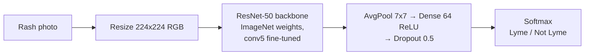

<div align="center">

# 🩺 Lyme Rash Classifier

**Deep learning that flags the "bullseye" rash of early Lyme disease from a single photo, running entirely in your browser.**

[](https://huggingface.co/spaces/nishanthharish/lyme-rash-classifier)
[](https://www.python.org/)
[](https://www.tensorflow.org/)
[](https://www.tensorflow.org/js)
[](LICENSE)
<!-- RESULTS-BADGE: update the number when the model changes -->
[](#-results)

[**▶ Try the live demo**](https://huggingface.co/spaces/nishanthharish/lyme-rash-classifier) · [Results](#-results) · [How it works](#-how-it-works) · [Roadmap](#-roadmap)


</div>

> [!WARNING]
> **Not a medical device.** This is a research project. It cannot diagnose Lyme disease, and a negative result does not rule it out. If you have a suspected tick bite or an expanding rash, see a doctor.

## ✨ Highlights

- **Private by design:** the model runs client-side with TensorFlow.js, so photos never leave the user's device.
- **Transfer learning:** ResNet-50 pretrained on ImageNet, fine-tuned in two stages on dermatological images.
- **Honest evaluation:** I found that most of the dataset was duplicated (`x.jpg` and `x copy.jpg`), so the same images leaked into both training and test and inflated my thesis accuracy to 80.8%. I deduplicated by content hash, retrained, and report the honest 75.3% on a leak-free test split.
- **Lightweight deployment:** 8-bit quantized weights (23 MB, down from 207 MB) with no accuracy loss, served as a free static site.

## 🎯 Problem

Erythema migrans, the expanding "bullseye" rash, is the earliest visible sign of Lyme disease and appears in most cases. Treating early prevents serious complications, but the rash is easy to confuse with other skin conditions. This project asks: **how well can a fine-tuned ResNet-50 tell Lyme rashes apart from other skin lesions?**

It began as my MSc Data Analytics thesis at Dublin Business School, *Predictive Modeling of Lyme Disease Detection Using Deep Learning* (supervisor: Meghana Kshirsagar, January 2024).

## 🧠 How it works



| Step | Details |
| --- | --- |
| Data | Kaggle [Lyme Disease Rashes](https://www.kaggle.com/datasets/sshikamaru/lyme-disease-rashes) plus web-sourced images. 2,060 files, **987 unique** after hash dedup. Split 711 train / 78 val / 198 test. Images are not redistributed here. |
| Augmentation | Rotation ±25°, zoom and shift ±10%, horizontal flip |
| Stage 1 | Frozen backbone, train head with Adam (lr 1e-4), batch 32, early stopping |
| Stage 2 | Unfreeze the last residual block (`conv5`), fine-tune at lr 1e-5 |
| Export | TensorFlow.js graph model, uint8 quantized (23 MB) |

## 📊 Results

<!-- RESULTS:START  Source: training/metrics.json and training/classification_report.txt. Update this block when the model changes. -->
Evaluated on **198 held-out test images** that never appear in training.

| Class | Precision | Recall | F1 |
| --- | :---: | :---: | :---: |
| Lyme (Positive) | 0.87 | 0.60 | 0.71 |
| Not Lyme (Negative) | 0.69 | 0.91 | 0.78 |
| **Accuracy** | | | **75.3%** |

Confusion matrix (rows are true labels):

| | Predicted Negative | Predicted Positive |
| --- | :---: | :---: |
| **True Negative** | 88 | 9 |
| **True Positive** | 40 | 61 |
<!-- RESULTS:END -->

**What this means:** when the model says "Lyme" it is usually right, but it currently misses about 4 in 10 Lyme rashes. Raising that recall is the main goal of version 2.0. The quantized browser model scores the same as the full Keras model.

## 🚀 Run it yourself

**Web app** (no install beyond Python):

```bash
cd web-app
python -m http.server 8000
# open http://localhost:8000
```

**Retrain** (put the dataset in a folder with `Negative/` and `Positive/` subfolders):

```bash
pip install tensorflow scikit-learn
python training/train.py path/to/dataset output_dir improved
```

**Gradio app:** see [`gradio-app/`](gradio-app/README.md).

## 📁 Repository layout

```
lyme-rash-classifier/
├── notebook/      Original thesis notebook (Google Colab)
├── training/      train.py, metrics.json, classification report
├── web-app/       Deployed in-browser app (index.html, tf.min.js, TF.js model)
└── gradio-app/    Alternative Python/Gradio app
```

## 🗺️ Roadmap

**Version 2.0** (in progress)

- [ ] **"Not a skin photo" detection:** recognise and reject images that are not skin lesions (pets, objects, scenery) instead of forcing a Lyme / not-Lyme answer
- [ ] **Higher Lyme recall:** threshold tuning, class weighting, stronger backbones (EfficientNet, ConvNeXt)
- [ ] **Professional app redesign** with confidence display and clearer guidance
- [ ] **Grad-CAM heatmaps** showing which part of the image drove the prediction
- [ ] More diverse, clinically labelled data across skin tones and lesion stages

## ⚠️ Limitations

- Small dataset (987 unique images) of web photos with varied lighting and quality.
- No labels for skin tone, lesion stage or body site, so fairness across those groups is untested.
- Not clinically validated.

## 🛠️ Tech stack

Python · TensorFlow / Keras · scikit-learn · TensorFlow.js · Google Colab · Hugging Face Spaces

## 📚 References

- Hossain, S.I. et al. (2021). Benchmarking convolutional neural networks for diagnosing Lyme disease from images. arXiv:2106.14465.
- Hossain, S.I. et al. (2022). Exploring convolutional neural networks with transfer learning for diagnosing Lyme disease from skin lesion images. *Computer Methods and Programs in Biomedicine*, 215, 106624.
- He, K. et al. (2016). Deep residual learning for image recognition. CVPR.

## 👤 Author

**Nishanth Harish** · MSc Data Analytics, Dublin Business School
[GitHub](https://github.com/NishanthHarish) · [LinkedIn](https://www.linkedin.com/in/nishanth-harish)

Released under the [MIT License](LICENSE).
