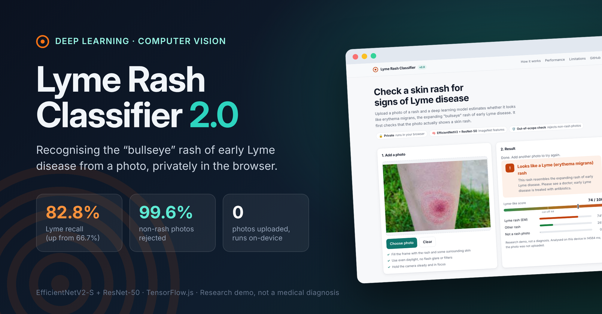
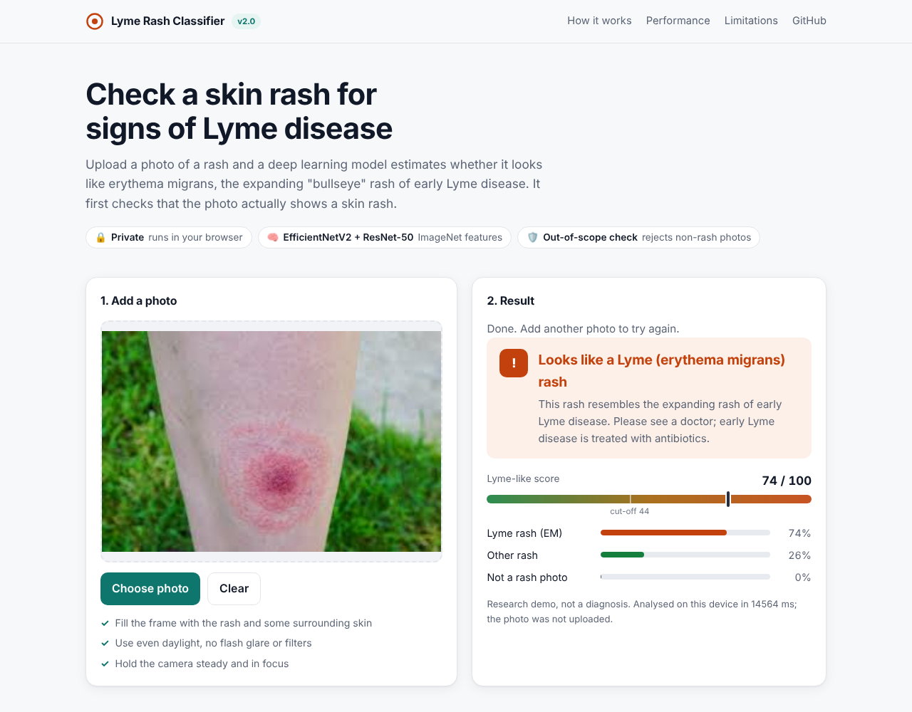
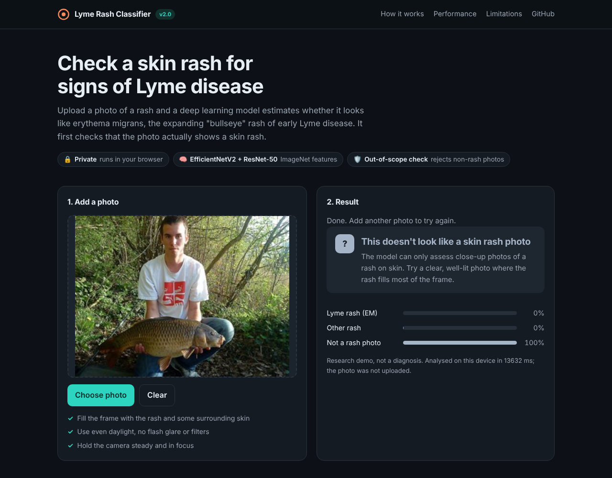
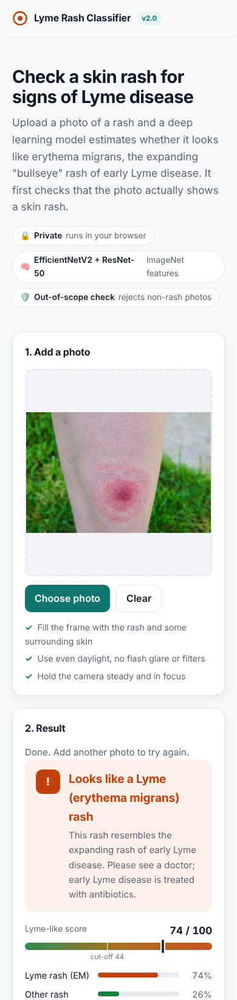
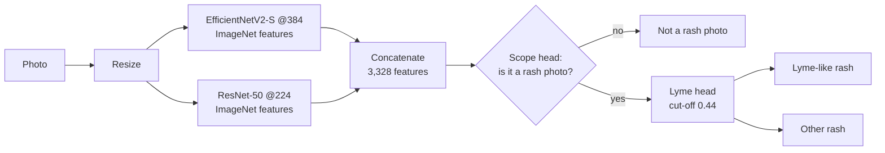

<div align="center">



# 🩺 Lyme Rash Classifier 2.0

**Deep learning that recognises the "bullseye" rash of early Lyme disease from a photo, and says so when a photo isn't a skin rash at all. It runs entirely in your browser.**

[](https://huggingface.co/spaces/nishanthharish/lyme-rash-classifier)
[](#-whats-new-in-20)
[](https://www.python.org/)
[](https://www.tensorflow.org/)
[](https://www.tensorflow.org/js)
[](LICENSE)
<!-- RESULTS-BADGE: update the numbers when the model changes -->
[](#-results)
[](#-results)

[**▶ Try the live demo**](https://huggingface.co/spaces/nishanthharish/lyme-rash-classifier) · [What's new](#-whats-new-in-20) · [Results](#-results) · [How it works](#-how-it-works) · [Roadmap](#-roadmap)

</div>

> [!WARNING]
> **Not a medical device.** This is a research project. It cannot diagnose Lyme disease, and a negative result does not rule it out. If you have a suspected tick bite or an expanding rash, see a doctor.

## 🆕 What's new in 2.0

| | v1 (thesis model) | **v2.0** |
| --- | --- | --- |
| Lyme rashes caught (recall) | 66.7% | **82.8%** |
| Rash accuracy | 75.5% | **77.6%** |
| Non-rash photos | Forced into Lyme / not-Lyme | **99.6% rejected as "not a rash photo"** |
| Model | Fine-tuned ResNet-50 | EfficientNetV2-S + ResNet-50 features, calibrated heads |
| App | Basic upload page | Redesigned: score bar, clear guidance, dark mode, mobile layout |

*v1 and v2.0 compared on the same stricter test split, with near-duplicate photos grouped so no copy of a test photo is in training.*

## 📸 The app

<table>
<tr>
<td width="50%"></td>
<td width="50%"></td>
</tr>
<tr>
<td align="center"><b>A Lyme-like rash</b>, with score and cut-off</td>
<td align="center"><b>Not a rash photo</b>, so no Lyme verdict is given</td>
</tr>
</table>

<details>
<summary>📱 Mobile view</summary>
<p align="center"></p>
</details>

## ✨ Highlights

- **Knows its limits:** a scope check rejects 99.6% of everyday photos, scenes and healthy skin, instead of guessing "Lyme" or "not Lyme" for a picture of a fish.
- **Built for sensitivity:** missing a Lyme rash is worse than a false alarm, so the decision cut-off was tuned on cross-validated data to catch 4 in 5 Lyme rashes, up from 2 in 3.
- **Private by design:** the model runs client-side with TensorFlow.js, so photos never leave the device.
- **Honest evaluation:** I found that most of the original dataset was duplicated, which had inflated my thesis accuracy to 80.8%. Version 2.0 removes exact and near-duplicates before splitting and reports results only on photos the model never saw.

## 🎯 Problem

Erythema migrans, the expanding "bullseye" rash, is the earliest visible sign of Lyme disease and appears in most cases. Treating early prevents serious complications, but the rash is easy to confuse with other skin conditions. This project asks: **how well can deep learning tell Lyme rashes apart from other skin lesions, and can it recognise when a photo isn't something it should judge?**

It began as my MSc Data Analytics thesis at Dublin Business School, *Predictive Modeling of Lyme Disease Detection Using Deep Learning* (supervisor: Meghana Kshirsagar, January 2024).

## 🧠 How it works



| Step | Details |
| --- | --- |
| Rash data | Kaggle [Lyme Disease Rashes](https://www.kaggle.com/datasets/sshikamaru/lyme-disease-rashes) plus web images. 2,060 files reduced to **967 unique photos** (445 Lyme, 522 other rashes) after exact and perceptual-hash dedup. Split 70/10/20 by near-duplicate group. |
| Out-of-scope data | 4,122 photos: Imagenette objects, Open Images scenes, Open Images crops of healthy hands, arms, legs and faces, and TF Flowers (test only, never seen in training) |
| Features | Frozen ImageNet backbones, flip-augmented, L2-normalised |
| Heads | Two logistic-regression heads (scope and Lyme), folded into Keras `Dense` layers so the whole pipeline is one model |
| Cut-off | 0.44, chosen on cross-validated development data (Youden's J) |
| Export | One TensorFlow.js graph model, 16-bit weights (87 MB). 8-bit cost ~5 accuracy points, so it wasn't used. |

Full training details, experiments and reproduction steps: [`training/v2/README.md`](training/v2/README.md).

## 📊 Results

<!-- RESULTS:START  Source: training/v2/metrics.json and training/v2/classification_report.txt. Update this block when the model changes. -->
**Rash photos:** 192 held-out test images (87 Lyme, 105 other rashes).

| Metric | v1 recipe, same split | **v2.0** |
| --- | :---: | :---: |
| Accuracy | 75.5% | **77.6%** |
| Lyme recall (sensitivity) | 66.7% | **82.8%** |
| Lyme precision | 76.3% | 72.0% |
| Other-rash recall (specificity) | 82.9% | 73.3% |
| ROC AUC | 0.829 | **0.841** |
| Real rashes wrongly rejected as "not a rash photo" | n/a | 1.0% |

Confusion matrix for v2.0 (rows are true labels):

| | Predicted other rash | Predicted Lyme |
| --- | :---: | :---: |
| **Other rash** | 77 | 28 |
| **Lyme** | 15 | 72 |

**Out-of-scope photos:** 1,142 held-out test images, **99.6% rejected** overall.

| Test set | Rejected |
| --- | :---: |
| Everyday objects (Imagenette) | 100% |
| Street, home and people scenes (Open Images) | 99.4% |
| Healthy skin: hands, arms, legs, faces | 98.9% |
| Flowers, a category never seen in training | 99.8% |
<!-- RESULTS:END -->

**What this means:** 2.0 catches 83% of Lyme rashes, up from 67%, by deliberately accepting more false alarms on other rashes. The browser model gives the same predictions as the Keras model (checked by running the real web page in headless Chromium). With 192 test rash photos, each figure is accurate to roughly ±3 percentage points.

## 🚀 Run it yourself

**Web app** (no install beyond Python):

```bash
cd web-app
python -m http.server 8000
# open http://localhost:8000
```

**Retrain 2.0:** see [`training/v2/README.md`](training/v2/README.md) for the data downloads and the full pipeline.

## 📁 Repository layout

```
lyme-rash-classifier/
├── web-app/         Deployed in-browser app (index.html, tf.min.js, TF.js model, model-info.json)
├── training/v2/     2.0 pipeline: dedup, out-of-scope data, features, heads, export, evaluation
├── training/        v1 retraining script and metrics
├── notebook/        Original thesis notebook (Google Colab)
├── gradio-app/      v1 Python/Gradio app
└── assets/          README images
```

## 🗺️ Roadmap

**Done in 2.0**

- [x] **"Not a rash photo" detection** for objects, scenes and healthy skin
- [x] **Higher Lyme recall:** stronger backbones and a tuned cut-off (66.7% → 82.8%)
- [x] **Professional app redesign** with score bar, guidance, dark mode and mobile layout

**Next**

- [ ] **Grad-CAM heatmaps** showing which part of the image drove the prediction
- [ ] More diverse, clinically labelled data across skin tones and lesion stages
- [ ] A smaller model for faster loading on phones

## ⚠️ Limitations

- Still a small dataset of web images (967 unique rash photos).
- No labels for skin tone, lesion stage or body site, so performance across those groups is unknown. Erythema migrans is harder to see on darker skin.
- Some rashes mimic each other even for dermatologists, so a photo alone cannot confirm Lyme disease.
- Not clinically validated.

## 🛠️ Tech stack

Python · TensorFlow / Keras · scikit-learn · TensorFlow.js · Hugging Face Spaces · Google Colab

## 📚 References

- Hossain, S.I. et al. (2021). Benchmarking convolutional neural networks for diagnosing Lyme disease from images. arXiv:2106.14465.
- Hossain, S.I. et al. (2022). Exploring convolutional neural networks with transfer learning for diagnosing Lyme disease from skin lesion images. *Computer Methods and Programs in Biomedicine*, 215, 106624.
- Tan, M. and Le, Q. (2021). EfficientNetV2: Smaller models and faster training. ICML.
- He, K. et al. (2016). Deep residual learning for image recognition. CVPR.

## 👤 Author

**Nishanth Harish** · MSc Data Analytics, Dublin Business School
[GitHub](https://github.com/NishanthHarish) · [LinkedIn](https://www.linkedin.com/in/nishanth-harish)

Released under the [MIT License](LICENSE).
